# Automated Resistor Color-Code Recognition and Sorting System

[](https://www.python.org/)
[](https://opencv.org/)
[](https://www.arduino.cc/)
[](https://www.espressif.com/)

## Project Overview

This four-person undergraduate electrical engineering capstone at **Feng Chia University** received **3rd Place, Senior Capstone Project Competition**. In Mar 2025, the group report was selected for the **Feng Chia University Outstanding Academic Papers by Students** database on the advisor's recommendation.

The system combines vision-guided resistor recognition with semi-automated mechanical sorting. An **ESP32-CAM** captures operator-triggered close-up resistor images and uploads them over HTTP to a **Python / OpenCV** host pipeline, which segments color bands and decodes three-band resistance values. An **Arduino Mega 2560** receives serial commands and coordinates **four 28BYJ-48 stepper motors** through **ULN2003 motor drivers** to actuate a **three-tier rotating storage mechanism** using open-loop positioning, routing components into **26 configured resistance destinations** plus an unknown bin with operator-triggered recapture on unrecognized frames.

**Power and energy relevance:** The motor-control work includes an analysis of ULN2003 Darlington driver drop and dissipation, stepper holding power and per-cycle energy, and ESP32-CAM supply-rail integrity (brownout detection is disabled in firmware), each with a bench measurement plan.

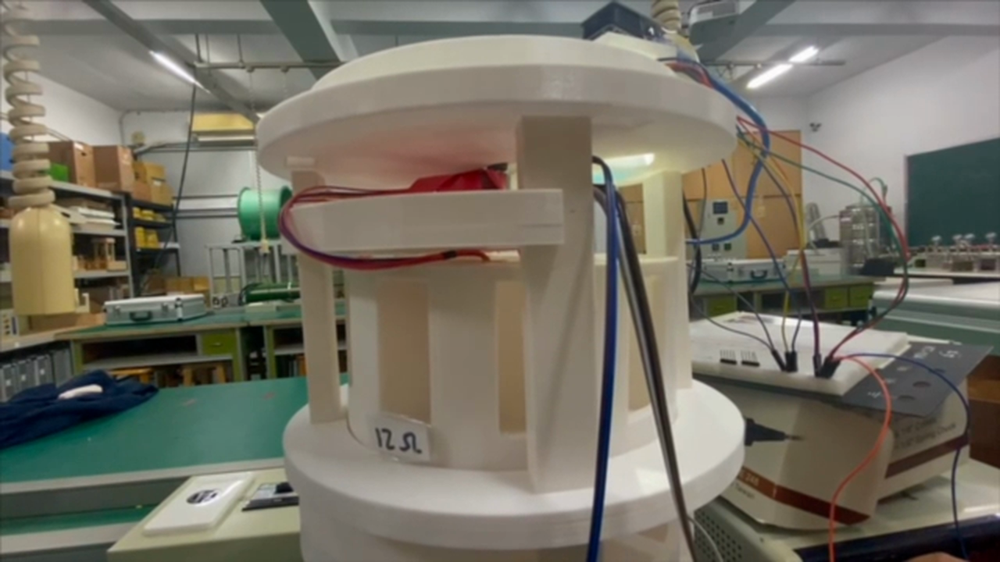

*Assembled three-tier resistor sorting prototype, from the [project video](https://youtu.be/1teDK1EO_dk).*

### Key Results at a Glance

| Area | Result | Basis |
| --- | --- | --- |
| Recognition (capstone) | About **80%** of roughly **100 resistor types** recognized with one fixed HSV configuration | Team estimate; per-trial records not retained |
| Sorting capacity | **26 resistance destinations** plus an unknown bin across three 36°-indexed layers | Firmware routing table |
| Sort cycle time | **5.6 s** (36° route) to **13.6 s** (324° / unknown route) | Derived from firmware constants |
| Motor-rail power | **3.20–3.36 W** with all four motors holding; about **18–19 J** per 36° sort cycle | Analytical model from datasheet values |
| Software verification | **47/47** automated tests pass; **3** firmware sketches compile | Reproducible in this repository |

## My Engineering Contributions

This was a **four-person undergraduate team project**. **Chien-Ta Chiang** contributed in three core areas:

1. **Arduino stepper motor control:** Developed the Arduino Mega stepper firmware ([`resistor_sorter.ino`](src/firmware/resistor_sorter/resistor_sorter.ino) and [`stepper_control.h`](src/firmware/resistor_sorter/stepper_control.h)) coordinating four motor channels (`M1`–`M4`), including the 26-entry resistance routing table plus unknown bin, storage-layer positioning, platform-paddle actuation, and commanded open-loop return movements.
2. **Three-tier mechanical concept:** Proposed the rotating pass-through storage architecture (using a $0^\circ$ through-hole to cascade parts across three layers) to expand bin capacity, and collaborated with CAD teammates on drop-path alignment, shaft fit, and mechanical integration.
3. **Vision and system integration:** Co-calibrated OpenCV HSV thresholds and morphological filtering, integrated the Python-to-Arduino 9600-baud serial command interface and `MOTOR_ADJUST` retry workflow, and participated in hardware troubleshooting and system testing.

See [CONTRIBUTIONS.md](CONTRIBUTIONS.md) for the complete division of team responsibilities and post-graduation software work.

## System Architecture

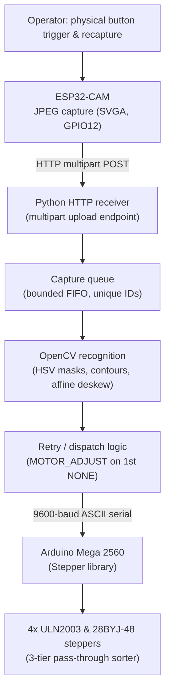

**System components:**
- **Capstone system:** Operator-triggered ESP32-CAM capture (`GPIO12`), OpenCV HSV/contour recognition (no neural network), a two-stage `MOTOR_ADJUST` retry policy with manual recapture, 9600-baud serial dispatch, and open-loop Arduino stepper actuation.
- **Upload receiver:** [`upload_server.py`](src/vision/upload_server.py) serves the camera's multipart upload endpoint in Python. The capstone demonstration used an XAMPP/PHP endpoint with the same interface.
- **Capture queue:** [`capture_queue.py`](src/vision/capture_queue.py) adds bounded persistent queuing with independent capture IDs and strict input/configuration validation.

| Subsystem | Hardware / technology | Implemented role |
| --- | --- | --- |
| Image acquisition | ESP32-CAM (OV2640), +40D lens, GPIO12 button | Operator-triggered SVGA JPEG capture and HTTP POST |
| Host upload intake | Python HTTP receiver, bounded FIFO queue | Validates multipart uploads and queues distinct capture events |
| Computer vision | Python 3.11, OpenCV 4.9, NumPy, HSV thresholds | Resistor localization, affine deskew, and three-band decoding |
| Host–MCU link | `pyserial`, 9600 baud, LF-terminated ASCII | Sends `<ohms>`, `MOTOR_ADJUST`, or `NONE` (no completion ACK) |
| Motion control | Arduino Mega 2560, `Stepper` v1.1.3, 4× ULN2003 | Drives four 5 V 28BYJ-48 steppers across 26 routes + unknown |

## Power, Driver and Timing Analysis

The prototype was powered from a bench power supply with a common ground. Figures below are calculated from datasheet values and firmware constants.

- **Motor drivers and holding power:** ULN2003 Darlington drivers ($V_{CE(\text{sat})}$ about 0.8–1.0 V) with `COM` flyback clamping; Arduino `Stepper` leaves two phases energized after any nonzero `step()` call; estimated hold draw 0.160–0.168 A (0.80–0.84 W) per motor, 3.20–3.36 W from the 5 V motor rail if all four motors hold (motors plus ULN2003 drivers, excluding logic boards). Each sort rotates only one storage layer at a time, while previously moved motors stay energized.
- **Motion timing:** Firmware-derived durations 5.644 s (36° route), 13.647 s (324° / unknown route), 3.655 s (`MOTOR_ADJUST`, 0.345 s margin inside the 4.0 s host wait); a +1.57° in-cycle offset at 324° if the motors use the ~63.684:1 gear-train variant (2048 steps/rev is configured).
- **Energy and power integrity:** With all four motors holding, one 36° sort cycle draws about 18.1–19.0 J from the motor rail (3.20–3.36 W × 5.644 s, including ULN2003 driver losses), or about 23.1 J including the logic boards (about 4.1 W). The ESP32-CAM firmware disables brownout detection; the consequences and a bench test plan are analyzed in the hardware document.

See [Hardware, BOM, power integrity and timing analysis](docs/hardware_and_bom.md) for full derivations and the bench measurement plan.

## Engineering Challenges & Solutions

| Challenge | Implemented approach | Remaining limitation |
| --- | --- | --- |
| **1. Close-range imaging & +40D optics** | Fixed a +40-diopter convex lens (nominal focal length $f$ of about 25 mm, 1/40 D) in front of the ESP32-CAM to resolve narrow resistor color bands ([before/after](docs/images/lens_before_after.jpg)) | Focus depends on the fixed lens-to-resistor distance set by the inspection platform |
| **2. Illumination & HSV band segmentation** | The team first considered a trained recognition model but judged classical HSV segmentation sufficient for the capstone scope. Compared ring-light and LED-bar illumination ([lighting study](docs/images/lighting_comparison.jpg)), added a lamp opening to the platform, then applied HSV body/band masks, morphology (skipping erosion on thin purple bands), and large black-blob suppression | Thresholds—especially gray and white—remain sensitive to ambient lighting changes. A single global HSV configuration could not cover every resistor: in the team's tuning, adjusting for reflective or hard-to-separate bands made many other resistors fail, so the team kept one configuration for the broader test set and routed unrecognized parts to the unknown bin |
| **3. Affine deskew & reading direction** | Estimated long-axis tilt via `cv2.minAreaRect`, applied affine rotation, and used terminal-band-to-body-edge distances to set reading direction | Decodes only the first three selected bands; tolerance bands and general 5-/6-band resistors are unsupported |
| **4. Motor sequencing & three-tier sorting** | Sequenced non-target layers at $0^\circ$ pass-through, indexed target disc in $36^\circ$ steps, actuated M4 paddle (`+46°` then `−10°`: the extra 10° keeps resistors from catching on the hole edge), and returned via opposite steps | Open-loop return without home sensors or encoders; `MOTOR_ADJUST` truncation leaves `+1` net step, and `Stepper` keeps coils energized |
| **5. ESP32-CAM bring-up & power/thermal stability** | Worked through overheating, latency and focus problems during bring-up; cross-tested boards, camera modules, cables and hosts to isolate `0x105` (`ESP_ERR_NOT_FOUND`) probe failures; firmware disables brownout detection (`RTC_CNTL_BROWN_OUT_REG = 0`) | `0x105` is an SCCB probe failure, separate from the heating issue; supply-rail droop under Wi-Fi bursts is the next item to measure |

Detailed optical/mechanical troubleshooting and calibration steps are in [Troubleshooting and calibration](docs/troubleshooting_and_calibration.md), and the full BOM, ULN2003 driver circuit, power/energy model, timing derivations, and ESP32-CAM brownout validation plan are in [Hardware and BOM](docs/hardware_and_bom.md).

## Project Demonstration & Visuals

### Prototype Video Excerpts

| Inspection platform | Storage compartments |
| --- | --- |
| 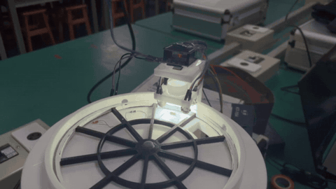 | 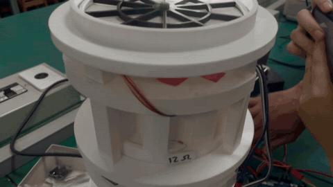 |

*Left: the inspection platform as a resistor is placed for capture. Right: a labeled storage compartment of the three-tier tower.*

<details>
<summary>Additional view: assembled storage tower</summary>

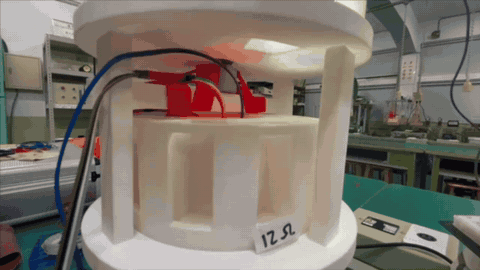

*Walk-around view of the assembled three-tier storage tower.*

</details>

**Full source video:** [Watch the project video on YouTube](https://youtu.be/1teDK1EO_dk).

### CAD Design and Computer Vision

<p align="center">
  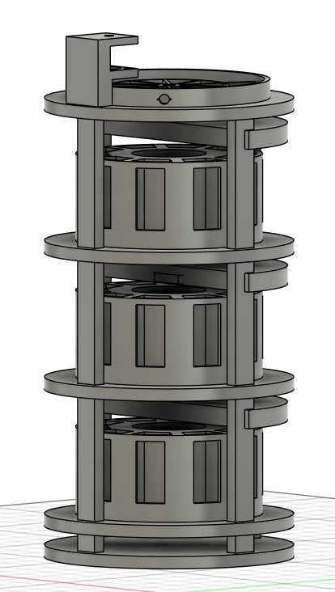
  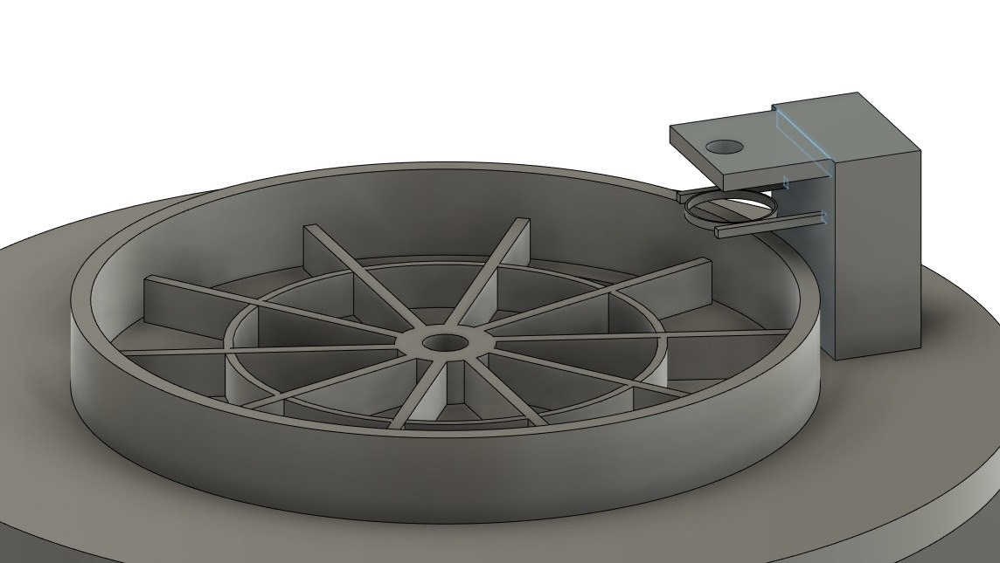
</p>

*CAD illustrations of the full three-tier sorting assembly (left) and top inspection platform (right). Additional views of the rotating storage disc ([storage_mechanism.jpg](docs/images/storage_mechanism.jpg)) and an AI-assisted explanatory diagram of the three-tier pass-through concept ([three_tier_storage_3d.png](docs/images/three_tier_storage_3d.png); not a team CAD export) are cataloged in [media notes](docs/images/README.md).*

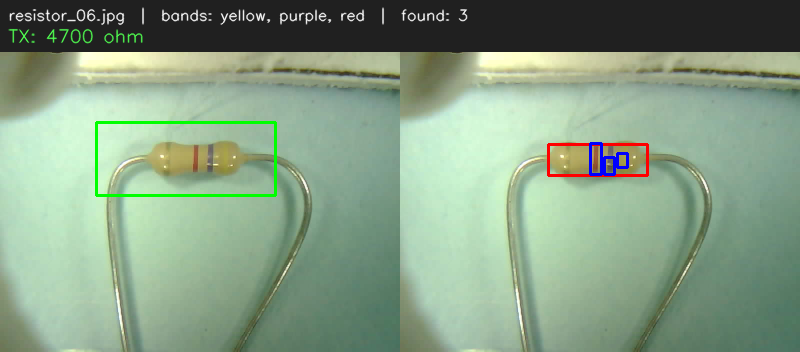

*OpenCV pipeline output on sample `resistor_06.jpg`: tilted body contour detection (left) and affine-rectified band candidates decoded as yellow–violet–red → `4700` Ω (right).*

### Engineering Iteration

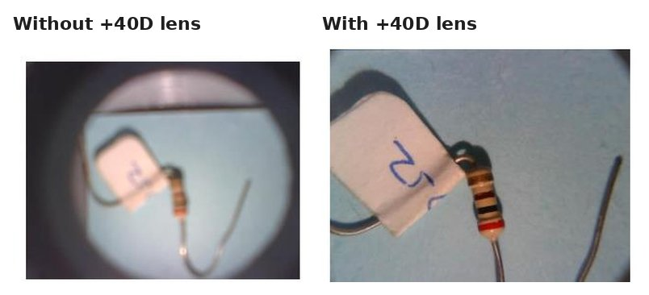

*Close-range imaging before and after adding the +40 D lens.*

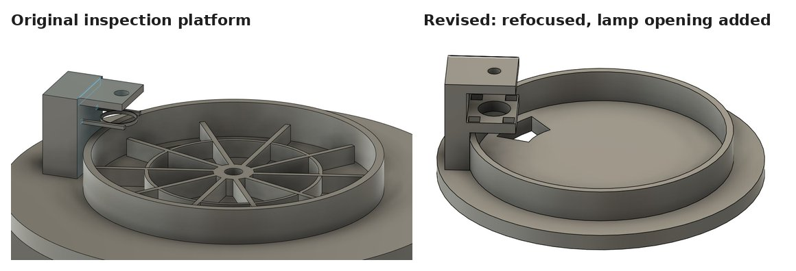

*Inspection-platform revision: the camera height was refocused and a lamp opening added to remove side-lighting shadows.*

The full March–November 2024 history, including the lighting study, the orientation-correction prototype and an OCR experiment that was not adopted, is in [Design evolution](docs/design_evolution.md). The printable STL parts are in [`hardware/cad/`](hardware/cad/README.md).

## Results & Validation

| Category | Result | Method |
| --- | --- | --- |
| **Capstone recognition test** | About **80%** of roughly **100 resistor types** (collected from other lab courses) recognized correctly with a single fixed HSV configuration | Team testing on the inspection platform (per-trial records not retained) |
| **Capstone sorting demonstration** | Selected, reliably recognized resistors sorted into their assigned compartments; recognized values outside the storage configuration routed to the unknown bin. The firmware defines **26 resistance destinations** plus a separate unknown bin | Live demonstration on the assembled prototype |
| **Capstone run logs** | ESP32-CAM upload acknowledged with `HTTP/1.1 200 OK`; host decodes and sends the value (`12`) to the Arduino ([screenshots](docs/images/original_run_evidence.png)) | Camera serial monitor and host console |
| **Offline sample regression** | 8 sample captures reproduce their baseline commands (`12`, `300`, `510`, `560`, `750`, `4700`, `5600`, `75000` Ω) | `tests/baselines/approved_samples.json` |
| **Historical capture regression** | 117 capstone captures: 60 numeric results, 57 `NONE`; 5 command differences from the original capstone detector | `tools/verify_private_regression.py` (capture set not distributed) |
| **Automated software suite** | **47 tests passed** (16 recognition/dispatch regression tests + 31 reliability tests) | Mocked serial port and localhost HTTP |
| **Firmware build** | **3 sketches compiled** (`resistor_sorter.ino`, `motor_control.ino`, `esp32_cam.ino`); sorter uses 2% flash and 7% SRAM on the Mega 2560 | Arduino CLI 1.6.0 |

<details>
<summary>View the eight sample predictions (<code>assets/sample_resistors/</code>)</summary>

| Sample | Predicted command (Ω) | Configured destination |
| --- | ---: | --- |
| `resistor_01.jpg` | 12 | Layer 1, 36° |
| `resistor_02.jpg` | 300 | Layer 1, 144° |
| `resistor_03.jpg` | 510 | Layer 2, 144° |
| `resistor_04.jpg` | 560 | Layer 2, 288° |
| `resistor_05.jpg` | 750 | Layer 2, 216° |
| `resistor_06.jpg` | 4700 | Layer 1, 288° |
| `resistor_07.jpg` | 5600 | Layer 1, 72° |
| `resistor_08.jpg` | 75000 | Layer 1, 180° |

A separate synthetic frame exercises the `MOTOR_ADJUST` → `NONE` retry path: only one band candidate is found, so the frame is routed to the unknown bin.

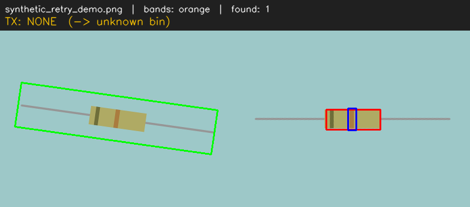

</details>

## Quick Start

Reproduce the offline demonstration, routing report, and 47-test suite without hardware (tested on Windows, CPython 3.11.4).

**Windows (PowerShell):**

```powershell
python -m venv .venv
.\.venv\Scripts\python.exe -m pip install -r requirements-lock.txt
.\.venv\Scripts\python.exe -X utf8 -B src/vision/main.py --mock
.\.venv\Scripts\python.exe -X utf8 -B tools/routing.py output/mock_results/summary.csv
.\.venv\Scripts\python.exe -X utf8 -B -m unittest discover -s tests -v
```

**Linux / macOS (bash or zsh, untested):**

```bash
python3.11 -m venv .venv
.venv/bin/python -m pip install -r requirements-lock.txt
.venv/bin/python -X utf8 -B src/vision/main.py --mock
.venv/bin/python -X utf8 -B tools/routing.py output/mock_results/summary.csv
.venv/bin/python -X utf8 -B -m unittest discover -s tests -v
```

Outputs are written to `output/mock_results/` (nine annotated PNGs and `summary.csv`). For Arduino CLI firmware builds and live mode instructions, see [Reproduction and build guide](docs/reproduction.md). Integrated live mode reads `upload_server.host: 0.0.0.0` from the settings file so the ESP32-CAM can reach the host over the LAN; if you run `src/vision/upload_server.py` on its own, pass `--host 0.0.0.0`, because its command-line default is `127.0.0.1`.

## Technical Documentation

- **Computer Vision & Recognition:** [Vision and decoding pipeline](docs/vision_and_algorithm.md)
- **Mechatronics & Motor Control:** [Mechatronics and sorting architecture](docs/mechatronics_and_control.md) · [Interfaces and command protocol](docs/protocol.md)
- **Hardware, Power Integrity & BOM:** [Hardware, BOM, power integrity and timing analysis](docs/hardware_and_bom.md) · [3D-printable CAD parts (STL)](hardware/cad/README.md) · [Mechanical and vision illustrations](docs/images/README.md)
- **Design History:** [Design evolution, March–November 2024](docs/design_evolution.md)
- **Troubleshooting & Calibration:** [Engineering troubleshooting and calibration](docs/troubleshooting_and_calibration.md)
- **Software & Reproducibility:** [System architecture](docs/architecture.md) · [Software and settings](docs/software.md) · [Capture delivery and recovery](docs/capture_delivery.md) · [Reproduction and build guide](docs/reproduction.md)
- **Validation:** [Validation and regression results](docs/validation.md) · [Sample resistor images](assets/sample_resistors/README.md)
- **Contributions & History:** [Contributions](CONTRIBUTIONS.md) · [Project history and sources](docs/provenance.md) · [Limitations and future work](docs/limitations.md)

## Limitations & Future Work

- **Manual capture & recapture:** Capture is triggered via physical `GPIO12` button press; the host has no shutter control or automatic part-presence trigger.
- **Open-loop motor positioning:** Zero references are manually aligned without limit switches, photo interrupters, or encoders, and `MOTOR_ADJUST` leaves a net `+1` step per adjustment.
- **No physical completion feedback:** Serial commands and HTTP `200` responses confirm transmission or queue admission rather than completed mechanical actuation.
- **Lighting sensitivity & decoder scope:** Fixed HSV thresholds (gray and white are the least robust) are lighting-dependent, and decoding covers three selected bands without tolerance or 5-/6-band support.
- **Next validation steps:** A labeled accuracy benchmark across lighting conditions, and bench power/thermal measurements including ESP32-CAM tests with brownout detection re-enabled.

See [Technical limitations and future improvements](docs/limitations.md) for details.

## Project History & Attribution

1. **Original Undergraduate Capstone:** Four-student electrical engineering capstone at Feng Chia University encompassing image recognition, Arduino motor control, ESP32-CAM capture/upload, and the three-tier mechanical sorter (see [Design evolution](docs/design_evolution.md) for the March–November 2024 history).
2. **Post-Graduation Refactoring:** Modularized the Python host workflow, implemented the camera upload endpoint in Python, and added offline demonstrations, calibration tooling, and 16 regression tests.
3. **Reliability Improvements:** Bounded FIFO capture queue, input/configuration validation, camera `2xx` HTTP checks, and 31 additional tests.

All post-graduation software work (refactoring, the Python receiver, tooling, and the 47-test suite) was developed with AI coding tools from task instructions I wrote (ChatGPT for planning, Codex for implementation) and reviewed by me. The capstone firmware and original recognition code are the team's 2024 work.

For contributor roles and project history, see [Contributions](CONTRIBUTIONS.md) and [Project history and sources](docs/provenance.md).

**Rights:** All rights reserved. No open-source license is provided. 
