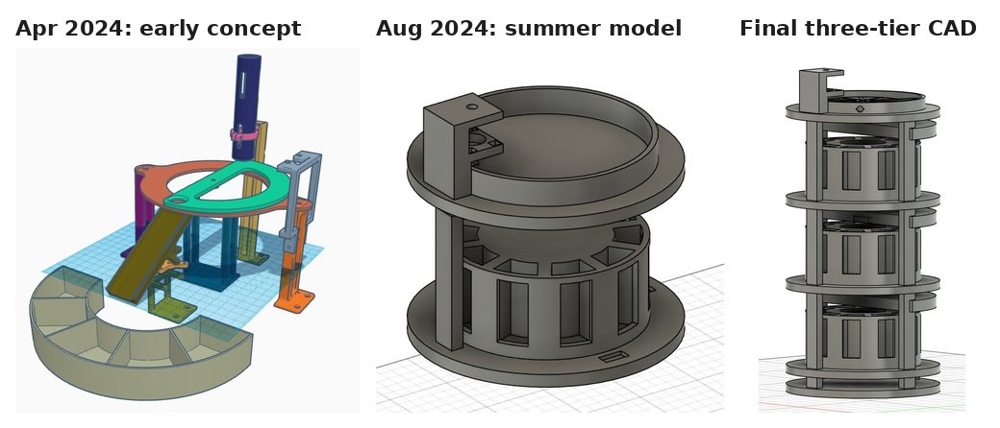
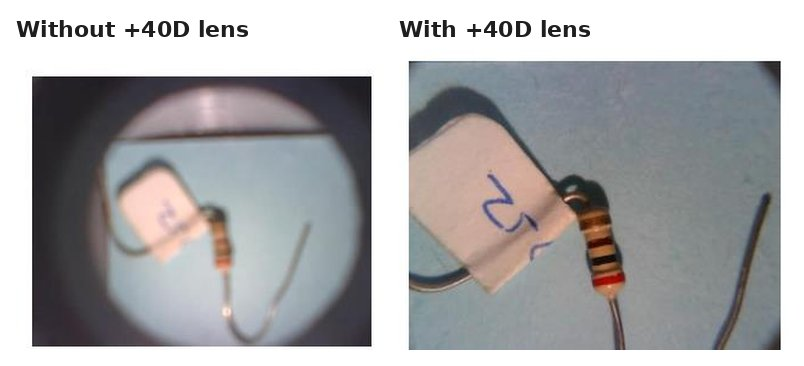
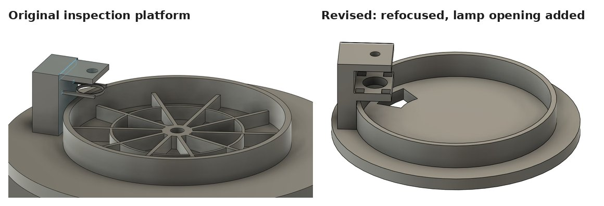
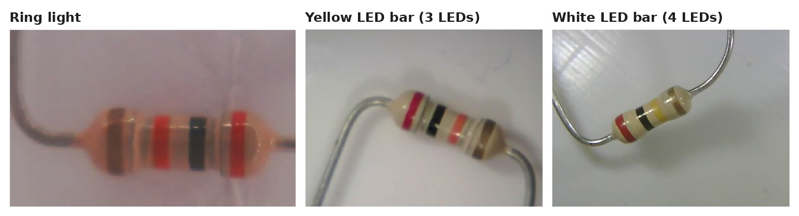
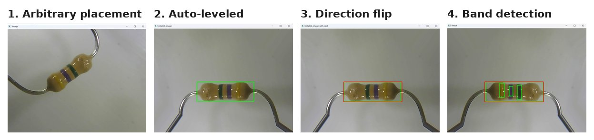
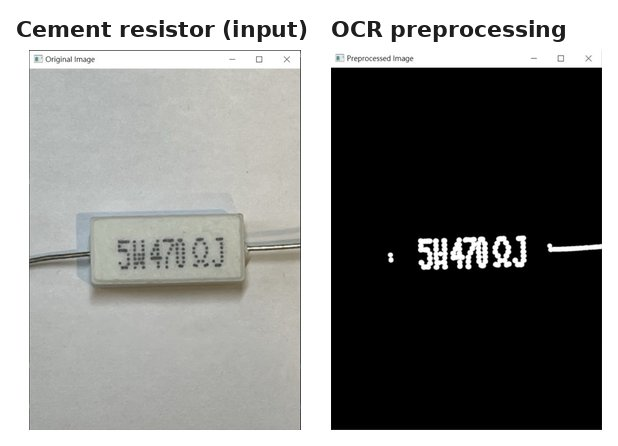

# Design Evolution (March–November 2024)

This page shows how the capstone design changed from the first concept to the final three-tier sorter.

*Left: April 2024 concept with a slide, turntable, inspection platform and storage tray. Center: August 2024 integrated model. Right: final three-tier pass-through tower.*

## Starting point

The project grew out of an earlier microprocessor-course project, a "smart resistor storage box". The capstone goal was to remove the manual sorting step: a camera reads each resistor's color bands, and motors deliver the part to the matching compartment.

## Timeline

| Period | State of the design | Key change or finding |
| --- | --- | --- |
| **Mar 2024** | Single resistors were placed horizontally by hand and photographed with a phone. The images were transferred to the PC for color reading. | The plan had two functions: **storing** (recognize, then move a slide and turntable to a compartment) and **searching** (enter a value on a keypad, show the result on a display, light an LED indicator). |
| **Apr 2024** | The planned hardware was an ESP32-WROOM-32 controller, SG90 hobby servos, a 4×4 keypad and LEDs. Automatic band-coordinate search worked on phone photos. The first ESP32-CAM captures were taken. | Side by side with a phone camera, the ESP32-CAM gave poor close-up images. The main camera problems were **chip overheating, latency, and inability to focus**. |
| **May 2024** | A test fixture held camera, lens and resistor at fixed distances. A **2.5 cm focal-length convex lens (+40 D)** solved the focus problem, and the HSV thresholds were retuned on fixture images. | The fixture had no lamp opening, so side lighting cast shadows that broke automatic orientation correction. The first test-printed storage box used more print time and filament than planned, so unused space was removed from the sector-shaped compartments. At this stage the mechanism used a drop motor, a floor-selecting chute and one motor per storage floor. |
| **Jun 2024** | New hardware architecture. A Python receiving server ran on the PC. SD-card auto-capture and OCR for cement resistors were tried. | Camera-not-found faults were isolated by swapping across three ESP32 boards, one Arduino Uno, four camera modules and several PCs. Expected summer risks included misreading precision resistors, camera instability, limited space and **insufficient motor torque**. |
| **Aug 2024** | Third-generation hardware: the inspection platform was **refocused and given a lamp opening**. Ring-light and LED-bar lighting were compared, and per-color HSV ranges were tuned against reference resistors. Automatic leveling and reading-direction flip worked. ESP32-CAM uploads to the Python server returned `HTTP 200`. | Motor commands went from Python over `pySerial` to an Arduino that still drove hobby servos through the `Servo` library. Gray and white bands proved easy to confuse with the metal end caps and the resistor body. |
| **Nov 2024** | Final system: ESP32-CAM button capture, upload to an XAMPP/PHP endpoint on the PC, Python watcher with OpenCV decoding, then a 9600-baud serial command to an **Arduino Mega 2560** driving **four 28BYJ-48 steppers** through ULN2003 boards. | The **three-tier rotating pass-through** storage replaced the chute-and-turntable concept, and steppers replaced the servos. About **80% of roughly 100 resistor types** were recognized correctly with a single fixed HSV configuration (team estimate; per-trial records were not retained; see [Validation](validation.md)). The keypad/LCD search function was dropped. |

## Supporting figures

### Close-range optics

*The bare ESP32-CAM lens cannot resolve the bands at close range; with the +40 D lens the bands are sharp.*

### Inspection platform revision

*The revised platform changed the camera's focal height and added a lamp opening, so the part is lit from above instead of from the side.*

### Illumination study

*August 2024 lighting comparison, used to choose a stable light source before retuning the HSV thresholds.*

### Orientation correction prototype

*First version of the deskew and reading-direction logic. It became the `minAreaRect` and affine-rotation stage in [`detector.py`](../src/vision/detector.py).*

### Explored but not adopted: OCR for cement resistors

*June 2024 experiment: thresholding isolated the printed marking `5W470ΩJ`, but OCR read it as `SH40Q`. The final system decodes color-band resistors only.*

## Cost and schedule

The project was planned at **60 days / NT$11,250** and finished in **90 days / NT$12,000**.

## Related pages

- [Hardware and BOM](hardware_and_bom.md) · [Mechatronics](mechatronics_and_control.md) · [Troubleshooting and calibration](troubleshooting_and_calibration.md)
- [3D-printable CAD parts](../hardware/cad/README.md) · [Project history and sources](provenance.md) · [Contributions](../CONTRIBUTIONS.md)
