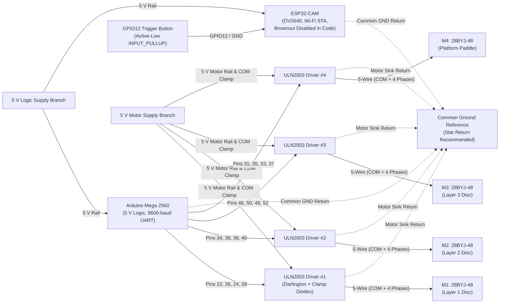

# Hardware Architecture, Bill of Materials, Power Integrity, and Timing Analysis

This document is the hardware reference for the resistor color-code recognition and sorting system: bill of materials, pin assignments taken from the firmware, ULN2003 and `Stepper` library behavior, and calculated power, energy and motion-timing figures, followed by the ESP32-CAM bring-up and power-integrity analysis.

---

## 1. Bill of Materials (BOM)

The table below lists the components of the integrated sorting system.

| Component | Quantity | Known specification | Function |
| --- | :---: | --- | --- |
| **Arduino Mega 2560** | 1 | ATmega2560 MCU (5 V logic); 16 digital outputs mapped to 4 motor channels; 9600-baud UART (`SERIAL_BAUD 9600`) | Receives ASCII resistance/adjustment commands and sequences M1–M4 steppers |
| **ESP32-CAM module** | 1 | AI-Thinker ESP32-CAM camera pin map; OV2640 sensor; 20 MHz XCLK (`GPIO0`); SVGA (`800×600`) JPEG (`jpeg_quality = 12`, `fb_count = 1`); 2.4 GHz Wi-Fi STA; 115200-baud diagnostic UART | Captures resistor images on button press and uploads JPEG via HTTP multipart POST |
| **28BYJ-48 stepper motors** | 4 | 5 V DC rated, 5-wire, 4-phase unipolar stepper motor with internal reduction gearbox; firmware configures `STEPS_PER_REV = 2048`, 12 RPM (M1–M3) and 6 RPM (M4 in sorter; 15 RPM in jog tool) | Positions three storage discs (M1–M3) and drives platform paddle/fan (M4) |
| **ULN2003 stepper driver boards** | 4 | 7-channel NPN Darlington low-side array IC (4 channels active per board), integrated `COM` flyback diodes, 5-pin JST-XH motor socket | Buffers 5 V Arduino GPIO logic to sink inductive stepper winding current |
| **Close-up macro lens** | 1 | `+40` diopter (`+40D`) convex close-up lens (nominal focal length $f = 1/40\text{ m} = 25\text{ mm}$) mounted in front of the ESP32-CAM lens | Shortens focal plane for close-range imaging of miniature color bands |
| **Inspection illumination** | 1 set | LED lighting through the inspection platform's lamp opening | Provides consistent illumination to stabilize HSV color segmentation |
| **Capture trigger button** | 1 | Momentary SPST push button wired between ESP32-CAM `GPIO12` (`INPUT_PULLUP`, active low) and `GND`; 50 ms firmware debounce | Triggers single-frame JPEG capture and HTTP upload |
| **Three-tier mechanical sorting assembly** | 1 assembly | Inspection platform above three stacked 10-slot ($36^\circ$ indexing) rotating storage discs with aligned $0^\circ$ pass-through apertures; shaft couplers. Printable STL exports from May–June 2024 are in [`hardware/cad/`](../hardware/cad/README.md) | Routes sorted resistors by gravity to 26 value bins plus 1 unknown compartment (Layer 1, $324^\circ$) |
| **DC power supplies and wiring harness** | — | Bench power supply providing nominal 5 V to the ULN2003/28BYJ-48 motors, Arduino Mega 2560, and ESP32-CAM (exact supply model and rail split not recorded) | Supplies operating power and common ground return across controllers, drivers, and camera |

### Cost and Superseded Early Components

- **Cost and schedule:** The project was planned at **60 days / NT$11,250** and completed in **90 days / NT$12,000**.
- **Superseded early components:** The April 2024 design used an ESP32-WROOM-32 controller, SG90 hobby servos, a 4×4 keypad and LED indicators, and the August 2024 prototype still drove its motors through the Arduino `Servo` library. The final assembly replaced these with the Mega 2560 and four steppers; see [Design evolution](design_evolution.md).

### Bring-Up Test Equipment (Not Part of the Final Assembly)

While debugging ESP32-CAM initialization and Wi-Fi issues, the team swapped in **three ESP32-CAM boards, one Arduino Uno, four camera modules, DuPont jumper cables, an ESP32-CAM programming/USB expansion board, and several host computers (up to three laptops and one desktop PC)**.

---

## 2. Firmware Pin Assignments

### 2.1 Motion Controller Pin Map (Arduino Mega 2560)

The pin sequences below match the exact argument order passed to the Arduino `Stepper` constructors in [`stepper_control.h`](../src/firmware/resistor_sorter/stepper_control.h) and [`motor_control.ino`](../src/firmware/motor_control/motor_control.ino):

| Channel | Assembly role | Arduino Mega pin arguments `(IN1, IN3, IN2, IN4)` | Sorter speed | Manual jog speed |
| --- | --- | --- | ---: | ---: |
| **M1** | Storage layer 1 (top) | `22, 26, 24, 28` | 12 RPM | 12 RPM |
| **M2** | Storage layer 2 (middle) | `34, 38, 36, 40` | 12 RPM | 12 RPM |
| **M3** | Storage layer 3 (bottom) | `46, 50, 48, 52` | 12 RPM | 12 RPM |
| **M4** | Inspection-platform paddle/fan | `31, 35, 33, 37` | 6 RPM | 15 RPM |

### 2.2 Camera and Trigger Connections (ESP32-CAM)

| Signal | GPIO / firmware setting |
| --- | --- |
| Capture button | `GPIO12`, `INPUT_PULLUP` (active low, 50 ms debounce) |
| Camera power-down (`PWDN`) | `GPIO32` |
| Camera reset (`RESET`) | `-1` (unused) |
| Master clock (`XCLK`) | `GPIO0`, 20 MHz (`LEDC_TIMER_0`, `LEDC_CHANNEL_0`) |
| SCCB `SDA` / `SCL` | `GPIO26` / `GPIO27` |
| Pixel bus `D7–D0` | `GPIO35 / 34 / 39 / 36 / 21 / 19 / 18 / 5` |
| Sync `VSYNC / HREF / PCLK` | `GPIO25 / 23 / 22` |
| Image configuration | `PIXFORMAT_JPEG`, `FRAMESIZE_SVGA` (`800×600`), `jpeg_quality = 12`, `fb_count = 1` |
| Brownout register | `WRITE_PERI_REG(RTC_CNTL_BROWN_OUT_REG, 0);` (disabled in `setup()`) |

---

## 3. ULN2003 Motor-Driver Circuit & Stepper Library Behavior

### 3.1 Why Arduino GPIO Cannot Drive Stepper Coils Directly

- **Current limits:** ATmega2560 digital I/O pins are specified at **40 mA absolute maximum** per pin (20 mA recommended continuous) and **200 mA total** across all `VCC`/`GND` package pins. By contrast, a 5 V 28BYJ-48 unipolar coil draws roughly **80–100 mA per phase** (160–200 mA per motor when two phases are energized simultaneously). Driving coils directly from GPIO would exceed pin and package limits and collapse logic output voltage.
- **Inductive transient protection:** Stepper stator windings are inductive loads ($V = L\,\mathrm{d}i/\mathrm{d}t$). Interrupting coil current without clamp diodes generates high-voltage flyback spikes capable of damaging CMOS output drivers on the microcontroller.

### 3.2 ULN2003 Darlington Switching, 5-Wire Connection, and Flyback Clamping

- **Low-side NPN Darlington switching:** Each ULN2003 channel integrates an NPN Darlington transistor pair rated up to $I_{C(\text{max})} = 500\text{ mA}$ (subject to total package thermal limits) with a built-in $2.7\text{ k}\Omega$ series base resistor sized for direct 5 V TTL/CMOS drive. When an Arduino pin outputs HIGH ($\approx 5\text{ V}$), roughly $1.3\text{ mA}$ of base current saturates the Darlington pair, sinking coil current from `OUTx` to `GND` (low-side switching).
- **Five-wire unipolar topology:** The 28BYJ-48 uses four stator phases ($A, B, A', B'$) sharing a common center-tap lead (typically red wire) connected to the positive $+5\text{ V}$ motor rail. The four phase leads attach to `OUT1`–`OUT4` on the ULN2003 driver board.
- **Flyback clamp diodes (`COM` pin):** Each ULN2003 channel includes an internal freewheeling diode whose anode connects to `OUTx` and whose cathode connects to the shared `COM` pin. When `COM` is tied to the $+5\text{ V}$ motor rail, turning off an inductive winding diverts stored magnetic energy through the clamp diode back to the positive supply rail, limiting collector voltage to $V_{\text{supply}} + V_F$ ($\approx 5.7\text{ V}$).
- **Darlington saturation drop ($V_{CE(\text{sat})}$) and driver dissipation:** Because a Darlington pair places the input transistor's $V_{BE}$ in series with the output transistor's saturation drop, $V_{CE(\text{sat})}$ cannot drop near zero as a single MOSFET would. At $\sim 80\text{–}100\text{ mA}$ per channel, $V_{CE(\text{sat})}$ is typically **0.8–1.0 V**, reducing effective voltage across the motor winding to $V_{\text{coil}} = V_{\text{supply}} - V_{CE(\text{sat})} \approx 4.0\text{–}4.2\text{ V}$ and dissipating heat ($P_{\text{driver}} = I_{\text{motor}} \cdot V_{CE(\text{sat})}$) inside the ULN2003 IC.
- **External motor supply and common ground return:** Motor coil current returns to the supply through the ULN2003 `GND` pin (`EMITTER`). To give the Arduino's logic output a valid $V_{BE}$ reference relative to the ULN2003 emitter, the Arduino `GND` and ULN2003 `GND` must share a common ground connection, while the high-current motor supply and return path should be routed separately from sensitive logic/camera rails (star-grounded at the power source) to avoid ground bounce and voltage droop.

### 3.3 Arduino `Stepper` Library Energization & Holding Behavior

Inspecting the official **Arduino `Stepper` library (v1.1.3)** reveals three critical behaviors that govern power consumption and holding torque:

1. **Two-phase-on full-step commutation:** The 4-pin constructor `Stepper(STEPS_PER_REV, pin1, pin2, pin3, pin4)` steps through a four-state **two-phase-on full-step** sequence: `1010 → 0110 → 0101 → 1001`. Passing pins in `(IN1, IN3, IN2, IN4)` order (e.g., `22, 26, 24, 28`) swaps the middle two signals so the two-phase library table energizes adjacent stator phases in the correct mechanical rotation order.
2. **Cold-boot state (unenergized before `step()`):** The `Stepper` constructor configures all four pins with `pinMode(..., OUTPUT)` without writing them HIGH; because AVR port output registers default to `0` on reset, **all four motors remain unenergized (`0000`, $0\text{ A}$) immediately after cold boot until `step()` is invoked with a nonzero step count**.
3. **Zero-step calls and persistent post-step holding:** Inside `Stepper::step(int steps_to_move)`, `steps_left = abs(steps_to_move)` is decremented in `while (steps_left > 0)`. Therefore, calling `step(0)` (for non-target storage layers whose angle is `0` in `moveLayers()`) returns immediately without modifying pin states. However, once a motor executes any nonzero `step()`, the library exits with **two phase pins still latched HIGH**—`Stepper` does **not** automatically de-energize windings after motion completes. Over successive sorting cycles touching Layers 1, 2, 3, and M4, up to **all four motors remain continuously energized in static hold**.

---

## 4. Conceptual Power-Domain Architecture

The prototype was powered from a bench power supply with a common ground; the exact rail split was not recorded. The diagram shows the signal connections defined in firmware and the recommended separation into logic and motor 5 V branches with a shared ground return.



---

## 5. Analytical Power and Energy Model

All current, power and energy figures in this section are calculated from datasheet values and the firmware's coil-energization behavior.

### 5.1 Per-Motor Model

Model parameters:
- Nominal motor supply rail: $V_{\text{supply}} = 5.0\text{ V}$.
- Nominal 5 V 28BYJ-48 per-phase DC coil resistance: $R_{\text{coil}} \approx 50\ \Omega$ (typical catalog value).
- Energized phases per active motor: $N_{\text{phases}} = 2$ simultaneous windings in Arduino `Stepper` full-step mode.
- ULN2003 Darlington saturation drop: $V_{CE(\text{sat})} \approx 0.8\text{–}1.0\text{ V}$ at $\sim 80\text{–}100\text{ mA}$.

**Ideal upper bound (ignoring Darlington $V_{CE(\text{sat})}$):**

$$I_{\text{phase,ideal}} = \frac{5.0\text{ V}}{50\ \Omega} = 0.100\text{ A}, \qquad I_{\text{motor,ideal}} = 2 \times 0.100\text{ A} = 0.200\text{ A}, \qquad P_{\text{motor,ideal}} = 5.0\text{ V} \times 0.200\text{ A} = 1.00\text{ W}$$

**Darlington-adjusted static hold estimate ($V_{CE(\text{sat})} = 0.8\text{–}1.0\text{ V} \implies V_{\text{coil}} = 4.0\text{–}4.2\text{ V}$):**

$$I_{\text{phase}} = \frac{V_{\text{supply}} - V_{CE(\text{sat})}}{R_{\text{coil}}} = \frac{4.0\text{ to }4.2\text{ V}}{50\ \Omega} = 0.080\text{ to }0.084\text{ A}$$

$$I_{\text{motor}} = 2 \times I_{\text{phase}} \approx \mathbf{0.160\text{ to }0.168\text{ A}}, \qquad P_{\text{rail,motor}} = 5.0\text{ V} \times I_{\text{motor}} \approx \mathbf{0.80\text{ to }0.84\text{ W}}$$

Of this $0.80\text{–}0.84\text{ W}$ drawn from the 5 V motor rail per holding motor, $0.64\text{–}0.71\text{ W}$ is dissipated in the motor windings and $0.13\text{–}0.16\text{ W}$ is dissipated inside the ULN2003 driver IC (neglecting driver board indicator LED current, typically a few milliamperes per active channel).

### 5.2 Operating-State Power Matrix

| Operating state | Expected active loads | Estimated rail current @ 5 V | Estimated average power @ 5 V | Basis |
| --- | --- | --- | --- | --- |
| **ESP32-CAM idle (Wi-Fi STA connected)** | ESP32-S + OV2640 active, no TX burst | $\sim 80\text{–}120\text{ mA}$ | $\sim 0.40\text{–}0.60\text{ W}$ | Typical ESP32-CAM idle/modem-sleep range; excludes the inspection LEDs |
| **ESP32-CAM capture & HTTP POST burst** | OV2640 frame grab + 802.11 TX peak | $\sim 180\text{–}310\text{ mA}$ avg (peaks up to $300\text{–}500\text{ mA}$) | $\sim 0.90\text{–}1.55\text{ W}$ avg (peaks $\sim 1.5\text{–}2.5\text{ W}$) | Wi-Fi TX RF pulses create sharp sub-millisecond transient droop risk |
| **Arduino Mega 2560 idle** | ATmega2560 + USB-UART bridge + LED | $\sim 50\text{–}90\text{ mA}$ | $\sim 0.25\text{–}0.45\text{ W}$ | Plus $\sim 2.6\text{ mA}$ GPIO base drive per holding motor ($\le 10.4\text{ mA}$ for 4 motors) |
| **Motors initially unenergized (cold boot)** | M1–M4 all `0000` prior to first `step()` | $0\text{ A}$ (motor rail) | $0\text{ W}$ (motor rail) | `Stepper` constructor leaves GPIO pins LOW; no motor holds at power-on |
| **One motor holding** | 1 motor × 2 phases ON (static) | $0.160\text{–}0.168\text{ A}$ (ideal: $0.200\text{ A}$) | $0.80\text{–}0.84\text{ W}$ (ideal: $1.00\text{ W}$) | Occurs after e.g. `MOTOR_ADJUST` before any layer has stepped |
| **Multiple / all four motors holding** | 2–4 motors × 2 phases ON (static) | 2 motors: $0.320\text{–}0.336\text{ A}$<br>4 motors: $0.640\text{–}0.672\text{ A}$ (ideal: $0.800\text{ A}$) | 2 motors: $1.60\text{–}1.68\text{ W}$<br>4 motors: $3.20\text{–}3.36\text{ W}$ (ideal: $4.00\text{ W}$) | `Stepper` never de-energizes coils; reaches 4 holding motors once M1, M2, M3, and M4 have each moved at least once |
| **One motor stepping while up to three hold** | 1 motor commuting sequentially; previously moved motors holding | $\le 0.640\text{–}0.672\text{ A}$ (ideal: $\le 0.800\text{ A}$) | $\le 3.20\text{–}3.36\text{ W}$ (ideal: $\le 4.00\text{ W}$) | `moveLayers()` and `pushWithFan()` call blocking `step()` sequentially, never concurrently; winding $L$ and back-EMF reduce dynamic current slightly below static DC hold |

### 5.3 Power vs. Energy and Bench Measurement Plan

Instantaneous/average **power** $P(t) = V(t)\,I(t)$ (measured in **watts, $\text{W}$**) determines supply current capacity, voltage droop, and steady-state heating, whereas **energy** (measured in **joules, $\text{J}$**, or **watt-hours, $\text{Wh}$**, where $1\text{ Wh} = 3600\text{ J}$) is the time integral over an interval $[t_1, t_2]$:

$$E = \int_{t_1}^{t_2} V(t)\,I(t)\,\mathrm{d}t \quad [\text{J}]$$

For example: if all four motors hold continuously ($\approx 3.3\text{ W}$) alongside active Arduino and idle ESP32-CAM logic ($\approx 0.8\text{ W}$, total $\approx 4.1\text{ W}$), a single $5.644\text{ s}$ sorting cycle ($36^\circ$ target) consumes roughly $E \approx 4.1\text{ W} \times 5.644\text{ s} \approx \mathbf{23.1\text{ J}}\ (\approx 6.4\text{ mWh})$, whereas leaving the system idle for 1 hour without coil release consumes $\approx 4.1\text{ W} \times 3600\text{ s} \approx \mathbf{14.8\text{ kJ}}\ (\approx 4.1\text{ Wh})$, mostly dissipated as static coil and driver heat.

Counting the 5 V motor rail alone (all four motors holding; motor windings plus ULN2003 driver losses, excluding logic boards), the same cycle draws $3.20\text{–}3.36\text{ W} \times 5.644\text{ s} \approx 18.1\text{–}19.0\text{ J}$.

The following bench measurements check these figures on hardware:

| Instrument | Test point | Target quantities | Required units |
| --- | --- | --- | --- |
| **DC inline power / energy meter** | Main 5 V motor PSU input and 5 V logic PSU input | Steady-state bus voltage, average current, average power, integrated cycle/hourly energy | $\text{V}$, $\text{A}$, $\text{W}$, $\text{J}$ or $\text{Wh}$ |
| **Precision shunt resistor + oscilloscope / current probe** | ESP32-CAM 5 V supply lead and ULN2003 common supply lead | Peak transient inrush/RF TX burst current, stepping vs. static holding waveform | $\text{A}$ (peak & RMS), $\text{ms}$ |
| **Digital storage oscilloscope (AC/DC coupled)** | ESP32-CAM `5V` & `3.3V` (`VDD3P3_RTC`) pins; Arduino `5V` rail | Voltage droop ($\Delta V_{\text{min}}$) during Wi-Fi TX and motor commutation; ripple | $\text{V}$, $\text{mV}_{\text{pp}}$, $\mu\text{s}$–$\text{ms}$ |
| **Thermocouple / calibrated IR thermometer** | ESP32-S shield, AMS1117-3.3 LDO, ULN2003 ICs, 28BYJ-48 motor housings | Steady-state temperature rise ($\Delta T$) over 30–60 min continuous hold/capture | $^\circ\text{C}$ |

---

## 6. Motion Timing Analysis

All motion durations below are derived directly from the constants in [`resistor_sorter.ino`](../src/firmware/resistor_sorter/resistor_sorter.ino) and [`stepper_control.h`](../src/firmware/resistor_sorter/stepper_control.h):

- `STEPS_PER_REV = 2048`, `STORAGE_SPEED_RPM = 12`, `FAN_SPEED_RPM = 6`.
- Storage step rate (M1–M3 at 12 RPM): $r_{12} = \frac{12 \times 2048}{60} = \mathbf{409.6\text{ steps/s}}$ ($2.44140625\text{ ms/step}$).
- Platform step rate (M4 at 6 RPM): $r_{6} = \frac{6 \times 2048}{60} = \mathbf{204.8\text{ steps/s}}$ ($4.8828125\text{ ms/step}$).
- Integer angle-to-step conversion `degToSteps(angle) = map(angle, 0, 360, 0, 2048)` (truncating toward zero): $+36^\circ \to +204$, $+324^\circ \to +1843$, $+46^\circ \to +261$, $-10^\circ \to -56$, $-20^\circ \to -113$, $+30^\circ \to +170$.
- Platform push (`M4`): the `+46°` sweep goes 10° beyond the net $36^\circ$ advance so the resistor does not catch on the hole edge, then returns `−10°`. After truncation the net move is `261 − 56 = 205` steps versus an exact $204.8$, so the paddle advances an extra `+0.2` step (about $+0.035^\circ$) per sort. If the motors use the ~63.684:1 gear train, the 205 commanded steps are about $36.21^\circ$ at the output, and that gear-ratio error dominates the truncation error.

### 6.1 Exact Step-Count and Delay Breakdown

| Sequence | Sub-step operation | Speed (RPM) | Commanded steps | Step time (s) | Firmware `delay()` (s) | Subtotal (s) |
| --- | --- | ---: | ---: | ---: | ---: | ---: |
| **$36^\circ$ sort cycle** | 1. Target layer forward (`+36°`) | 12 | `204` | `0.4980` | `1.0000` | `1.4980` |
| | 2. Platform push CW (`+46°`) | 6 | `261` | `1.2744` | `0.1000` | `1.3744` |
| | 3. Platform return CCW (`-10°`) | 6 | `-56` | `0.2734` | `1.0000` | `1.2734` |
| | 4. Target layer return (`-36°`) | 12 | `-204` | `0.4980` | `1.0000` | `1.4980` |
| | **Total ($36^\circ$ route)** | — | **`725` total** | **`2.5439`** | **`3.1000`** | **`5.6439` ($\approx 5.644\text{ s}$)** |
| **$324^\circ$ sort / unknown cycle** | 1. Target layer forward (`+324°`) | 12 | `1843` | `4.4995` | `1.0000` | `5.4995` |
| | 2. Platform push (`+46°` / `100 ms` / `-10°`) | 6 | `261 + 56` | `1.5479` | `1.1000` | `2.6479` |
| | 3. Target layer return (`-324°`) | 12 | `-1843` | `4.4995` | `1.0000` | `5.4995` |
| | **Total ($324^\circ$ / unknown route)** | — | **`4003` total** | **`10.5469`** | **`3.1000`** | **`13.6469` ($\approx 13.647\text{ s}$)** |
| **`MOTOR_ADJUST` sequence** | 1. Adjust step 1 (`-20°`) | 6 | `-113` | `0.5518` | `1.0000` | `1.5518` |
| | 2. Adjust step 2 (`+30°`) | 6 | `170` | `0.8301` | `1.0000` | `1.8301` |
| | 3. Adjust step 3 (`-10°`) | 6 | `-56` | `0.2734` | `0.0000` | `0.2734` |
| | **Total (`MOTOR_ADJUST`)** | — | **`339` total (net `+1`)** | **`1.6553`** | **`2.0000`** | **`3.6553` ($\approx 3.655\text{ s}$)** |

### 6.2 Comparison with Host Wait

- **`MOTOR_ADJUST` timing margin:** The Python host waits `retry.adjust_wait_s = 4.0` s ([`settings.example.yaml`](../config/settings.example.yaml), [`serial_bridge.py`](../src/vision/serial_bridge.py)) after dispatching `MOTOR_ADJUST`. Compared with the firmware-derived `3.655 s` sequence duration, the host wait leaves a theoretical **$0.345\text{ s}$ margin** ($4.000 - 3.6553 = 0.3447\text{ s}$). The `4 s` value comes from the capstone configuration and could be shortened toward the 3.655 s sequence time.
- **Scope of the calculation:** The durations cover firmware step pacing and `delay()` calls. They exclude JPEG capture and HTTP upload latency, OpenCV contour/affine inference time, 9600-baud UART framing and `Serial.readStringUntil('\n')` timeout behavior, `Serial.print()` overhead, operator recapture intervals, and physical effects such as motor stall, missed steps, or mechanical slip.

---

## 7. Step-Count and Gearing Uncertainty Analysis

Although [`stepper_control.h`](../src/firmware/resistor_sorter/stepper_control.h) configures `STEPS_PER_REV = 2048` (assuming an exact $64:1$ gear reduction with a 32-full-step rotor), a widely manufactured 28BYJ-48 gear-train variant actually uses a four-stage compound reduction:

$$G = \frac{32}{9} \times \frac{22}{11} \times \frac{26}{9} \times \frac{31}{10} = \frac{25792}{405} \approx 63.68395:1$$

$$N_{\text{full}} = 32 \times G \approx \mathbf{2037.886\text{ full steps/rev}}\ (\approx 2037.9\text{ steps/rev})$$

- **$324^\circ$ angular-error estimate:** For a $324^\circ$ target, `degToSteps(324)` commands $1843$ steps. If the installed motors belong to the $2037.886\text{ steps/rev}$ gear-train variant:

$$\theta_{\text{actual}} = 1843 \times \frac{360^\circ}{2037.886} \approx 325.57^\circ \implies \Delta\theta = 325.57^\circ - 324.00^\circ \approx \mathbf{+1.57^\circ}$$

- **Uncertainty and mechanical implications:**
  - 28BYJ-48 motors are sold with different gear trains (some $63.684:1$, others exactly $64:1$), so the size of this offset depends on the installed motors.
  - Because `sortResistor()` reverses the active layer by the exact negative step count (`-angle`), any gear-ratio scaling discrepancy cancels on return to $0^\circ$ rather than accumulating across sort cycles (unlike the `+1` integer-truncation residual in `MOTOR_ADJUST`). Whether a $+1.57^\circ$ in-cycle offset at $324^\circ$ matters depends on the compartment entrance width and drop-chute clearance, which are part of the bench measurement plan.

---

## 8. ESP32-CAM Bring-Up and Power Integrity Analysis

### 8.1 Bring-Up Issues

Four recurring issues came up while integrating the ESP32-CAM:
1. **No camera image:** Initial captures produced blank or missing image output.
2. **Wi-Fi connection problems:** Intermittent upload connectivity; router speed and the 2.4 GHz / 5 GHz band setting were the main suspects.
3. **Hardware cross-testing:** Multiple ESP32-CAM boards (3 units), spare camera modules (4 units), an Arduino Uno, DuPont jumper harnesses, an expansion board, and multiple host computers (laptops and desktop PCs) were rotated to isolate intermittent behavior.
4. **Probe failure (`0x105`):** Serial diagnostics reported `Camera probe failed with error 0x105` (`ESP_ERR_NOT_FOUND`).

The camera module also showed **chip overheating, latency and focus problems** early in the project. Better heat dissipation reduced the overheating in spring 2024, but latency, overheating and occasional network disconnection remained the main sources of camera instability, together with intermittent stalls during long runs.

### 8.2 Separating Error `0x105` from Thermal/Power Instability

- **Meaning of `0x105` (`ESP_ERR_NOT_FOUND`):** In the ESP-IDF `esp_camera` driver, `esp_camera_init()` returns `0x105` when the SCCB ($I^2\text{C}$-like) bus (`GPIO26`/`GPIO27`) fails to receive an acknowledgement from the OV2640 sensor ID register after asserting `XCLK` (`GPIO0`) and power/reset lines. Typical physical causes are a poorly seated 24-pin FPC ribbon connector, mismatched pin definitions, an unpowered camera sensor LDO, or a faulty camera module. **`0x105` is an initialization/SCCB probe failure, not direct evidence of thermal shutdown.**
- **Root cause of the long-run stalls:** Heating and stalls under sustained Wi-Fi/camera load point to thermal stress or supply-rail droop. The bench plan in Section 8.4 separates the two.

### 8.3 Brownout Detector Disable (`RTC_CNTL_BROWN_OUT_REG`) Analysis

Line 138 of [`esp32_cam.ino`](../src/firmware/esp32_cam/esp32_cam.ino#L138) executes:

```cpp
WRITE_PERI_REG(RTC_CNTL_BROWN_OUT_REG, 0);  // disable brownout detector
```

- **Purpose of hardware brownout detection:** The ESP32 brownout detector monitors `VDD3P3_RTC` and resets the chip automatically if supply voltage drops below its configured threshold ($\sim 2.43\text{–}2.80\text{ V}$). Because ESP32-CAM Wi-Fi TX bursts can draw $300\text{–}500\text{ mA}$ spikes through thin jumper wires or an under-rated 5 V / AMS1117-3.3 regulator, disabling brownout detection is a common workaround to suppress reset loops during Wi-Fi association.
- **Engineering risks of disabling brownout protection:** Removing the brownout reset does **not** fix the underlying rail droop. If `VDD3P3_RTC` or the SPI flash supply actually falls below minimum operating voltage ($2.3\text{–}3.0\text{ V}$ depending on flash part), the SoC can continue executing out-of-spec, leading to erratic peripheral behavior (including SCCB camera hangs), silent CPU lockups, or SPI flash corruption. The safer configuration is to fix the supply path (short, heavy 5 V leads and a regulator rated for the burst current) and then re-enable the detector.

### 8.4 Bench Validation Plan

Before deploying the camera in continuous service, run a separate diagnostic build of `esp32_cam.ino` on bench hardware to measure:
1. **Rail stability:** Capture 5 V input and onboard 3.3 V LDO output waveforms with an oscilloscope across Wi-Fi association, `esp_camera_fb_get()`, and `http.POST()` bursts.
2. **Reset-cause logging:** Re-enable the brownout detector in a test branch and log `esp_reset_reason()` over 115200-baud UART (`ESP_RST_BROWNOUT` vs. `ESP_RST_TASK_WDT` / `ESP_RST_PANIC`) while comparing stable bench PSU feeding vs. USB/jumper-wire feeding.
3. **Thermal profile:** Record ESP32-S shield and 3.3 V LDO temperatures over a timed multi-minute capture interval using a thermocouple or IR thermometer.

---

## 9. Related Documentation

- [Mechatronics, Motor Control and Sorting Architecture](mechatronics_and_control.md)
- [Engineering Troubleshooting and Calibration](troubleshooting_and_calibration.md)
- [Technical Limitations and Future Improvements](limitations.md)
- [Interfaces and Command Protocol](protocol.md)
- [README Mechanical Illustrations](../README.md#project-demonstration--visuals) and [Mechanical and Vision Illustrations](images/README.md)
