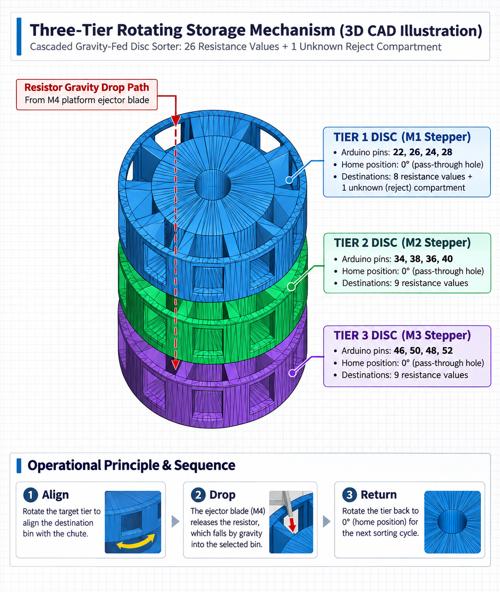
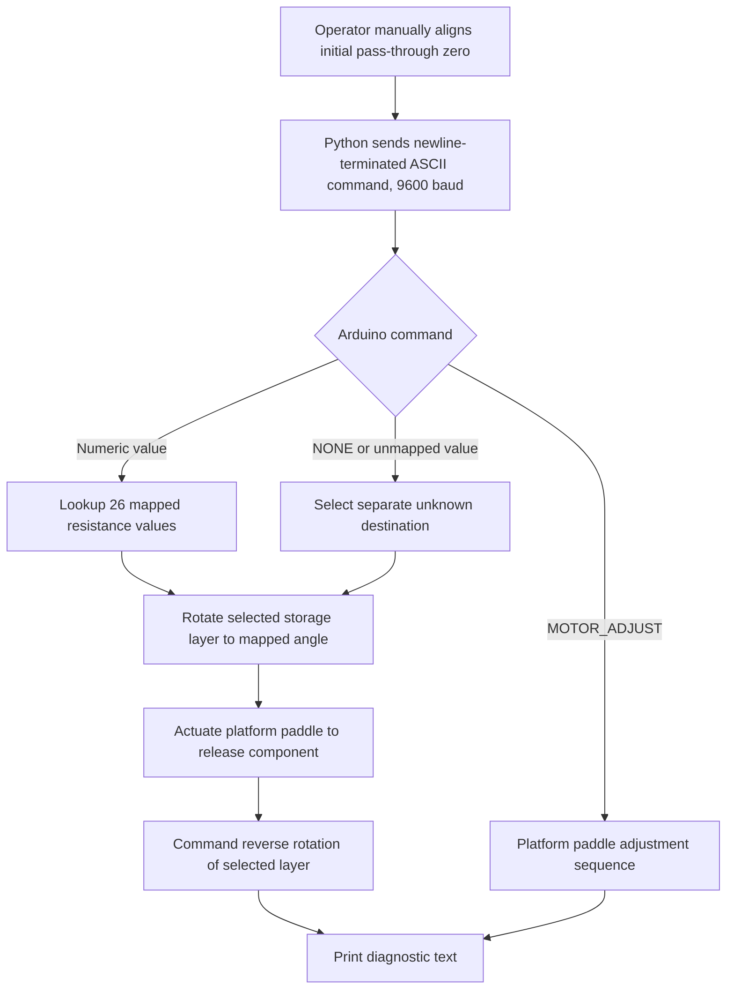

# Mechatronics, Motor Control and Sorting Architecture

## Hardware stack

The undergraduate prototype combined an **Arduino Mega 2560**, **four 5 V 28BYJ-48 stepper motors**, four **ULN2003 driver boards**, an ESP32-CAM image source, and a three-tier rotating pass-through storage assembly. The Arduino stepper outputs drive ULN2003 inputs; motor coils are not wired directly to MCU GPIO. See [hardware and BOM](hardware_and_bom.md) for the confirmed wiring and design caveats.

| Channel | Function | Arduino Mega pin arguments in firmware | Driver |
| --- | --- | --- | --- |
| M1 | Top storage layer | `22, 26, 24, 28` | ULN2003 |
| M2 | Middle storage layer | `34, 38, 36, 40` | ULN2003 |
| M3 | Bottom storage layer | `46, 50, 48, 52` | ULN2003 |
| M4 | Inspection-platform fan/paddle | `31, 35, 33, 37` | ULN2003 |

The pin argument **order** matches the physical ULN2003 wiring as passed to the Arduino `Stepper` constructors in [`stepper_control.h`](../src/firmware/resistor_sorter/stepper_control.h). Firmware speed constants are **12 RPM** for the storage layers and **6 RPM** for the platform paddle, using **2048 steps per revolution** for angle-to-step conversion. Note that the Arduino `Stepper` library leaves GPIO pins LOW at cold boot, executes moves sequentially (`moveLayers()` steps one motor at a time), and retains two energized phases on each motor after any nonzero `step()` call ($\sim 0.160\text{–}0.168\text{ A}$ estimated static hold per motor after Darlington $V_{CE(\text{sat})}$ drop). See [Hardware and BOM](hardware_and_bom.md) for the ULN2003 driver circuit, holding-current model, and conceptual power-domain diagram.

## Mechanism and indexing geometry

Three stacked discs use **10 nominal angular positions at 36-degree intervals**. The 0-degree reference is a pass-through position. A recognized resistance selects one configured disc and rotation angle; discs not selected stay at their manually aligned pass-through positions. After actuating the platform paddle, the firmware commands inverse step movements to return the selected layer to its starting reference.

The lookup table defines **26 resistance destinations** across layers 1–3 and **one separate unknown destination**: layer 1 at 324 degrees. The 26 entries are implemented in `SORT_TABLE`; `UNKNOWN_ENTRY` is a separate constant. See the authoritative [routing table in firmware](../src/firmware/resistor_sorter/stepper_control.h) rather than duplicating all resistor values here.

*AI-assisted explanatory diagram (not a team CAD export) of the three-tier rotating pass-through mechanism: each disc indexes in 36° increments around a manually aligned 0° pass-through slot. Actual part geometry is in the STL files below.*

Printable STL exports of the inspection platform, fan/paddle, storage discs and brackets are in [`hardware/cad/`](../hardware/cad/README.md). The path from the early slide-and-turntable concept and servo-driven prototypes to this stepper-driven tower is described in [Design evolution](design_evolution.md).

## Firmware movement sequence

The controller receives ASCII commands using `Serial.readStringUntil('\n')` and removes surrounding whitespace. The three command categories are a decimal resistance, `MOTOR_ADJUST`, and `NONE`. A numeric value that is not present in the table routes to the unknown bin, independently of the two-attempt recognition policy.

For a routed item, the selected layer moves to its configured angle while other layers remain at their current pass-through reference. The M4 paddle executes nominal **+46° then −10°** movements; the selected layer is commanded back by equal and opposite steps. The `MOTOR_ADJUST` path executes **−20°, +30°, −10°** nominal paddle movements (integer step conversion may leave nonzero net motion). The actual integer step conversion and sequencing are defined in [`resistor_sorter.ino`](../src/firmware/resistor_sorter/resistor_sorter.ino) and [`stepper_control.h`](../src/firmware/resistor_sorter/stepper_control.h).

From firmware constants and `delay()` intervals, the calculated motion durations are **5.644 s** for a 36° sort, **13.647 s** for a 324° / unknown sort, and **3.655 s** for `MOTOR_ADJUST` (leaving a **0.345 s** margin against the host's configured 4.0 s wait). In addition, if the installed 28BYJ-48 motors use the $\approx 63.684:1$ ($\approx 2037.9\text{ steps/rev}$) gear-train variant rather than exact $64:1$ ($2048$), a 324° move introduces a theoretical **$+1.57^\circ$** in-cycle offset. Full step-by-step calculations and caveats are detailed in [Hardware and BOM](hardware_and_bom.md).

## Open-loop control characteristics

The mechanism uses **manual zero-position alignment** and **open-loop step-count return**, without home switches or encoder feedback. The serial message `Homing done` marks completion of the reverse-step command sequence.

Python communicates over a **9600-baud, newline-terminated ASCII channel**. The host uses a configured delay after `MOTOR_ADJUST` rather than awaiting a motor-completion handshake from the Arduino.

Open-loop positioning relies on accurate initial alignment, consistent stepping, and an unobstructed drop path. Adding home sensors, limit switches, and explicit completion acknowledgements are noted in [Limitations and future improvements](limitations.md). Additional wiring and assembly details are in [Hardware/BOM](hardware_and_bom.md) and [Troubleshooting](troubleshooting_and_calibration.md).
