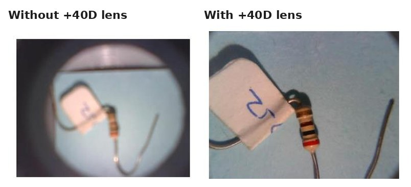
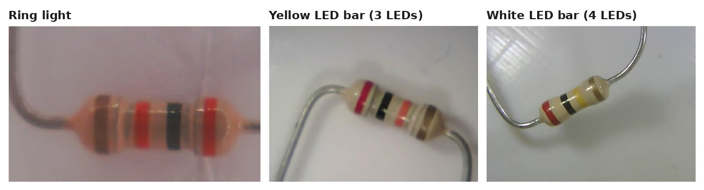
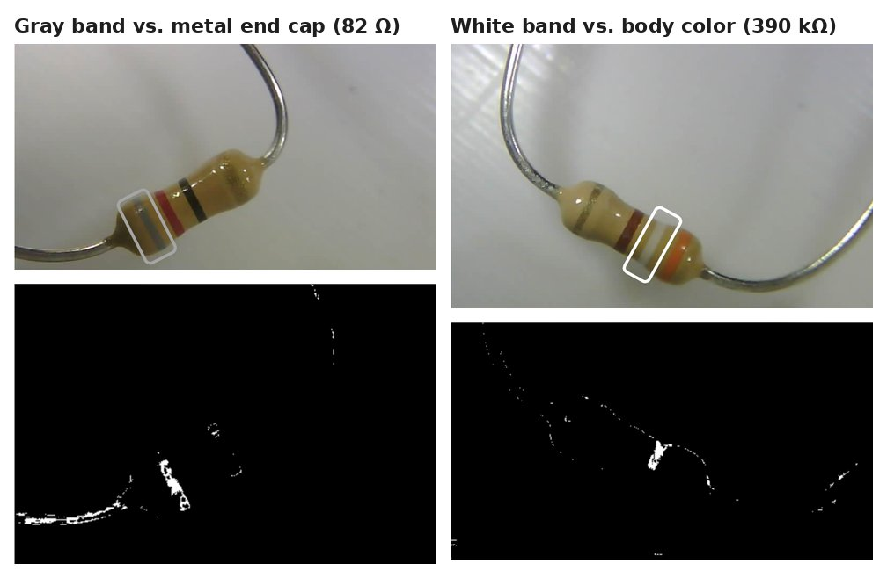
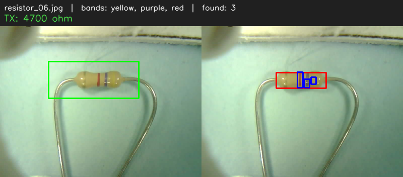

# Engineering Troubleshooting and Calibration

This guide summarizes the optical, algorithmic, and mechanical challenges addressed during system integration, along with calibration procedures for tuning HSV thresholds and mechanical alignment.

## 1. Optical acquisition: small bands, reflections and lighting

**Challenge:** The system recognizes narrow colored rings on small resistor bodies. Close focus, ambient shadows, glossy reflections, and inconsistent illumination can change apparent color and split candidate contours. The prototype uses close-up optics and controlled illumination, including a **+40-diopter lens**.

*Without the close-up lens, the ESP32-CAM cannot resolve the color bands at working distance (left). With the +40 D lens, the bands are sharp (right).*

**Iteration:** The May 2024 test fixture had no opening for a lamp, so the resistor was lit from the side. The resulting shadows broke the automatic orientation step. The redesigned platform moved the camera to a new focal height and added a lamp opening ([platform revision](images/platform_revision.jpg)). In August 2024 the team compared a ring light with yellow and white LED bars before retuning HSV thresholds. An early white background also made the resistor hard to separate from the fixture, so the background was changed to blue.

**Solution:** HSV body and band masks, morphological operations, contour filtering, and affine correction are used to isolate candidate rings. The segmentation includes targeted treatment of broad black regions and thin purple regions. Actual thresholds and filter sizes are defined in [the detector](../src/vision/detector.py) and [HSV configuration](../config/hsv_thresholds.json).

**Calibration note:** Color thresholds—especially gray and white—depend on local lighting and optics, and should be recalibrated with the HSV utility whenever the camera setup changes. The summer 2024 calibration shows why: a gray band is hard to separate from the metal end cap, and a white band from the beige resistor body.

*HSV masks (bottom) for a gray band next to the metal end cap (82 Ω, left) and a white band against the body color (390 kΩ, right). Neither mask isolates the target band cleanly.*

### ESP32-CAM bring-up and stability troubleshooting

- **Bring-up issues:** Blank camera output, Wi-Fi connectivity failures (router speed and band setting were the main suspects), cross-testing across multiple ESP32-CAM boards, camera modules, DuPont cables/expansion board, Arduino Uno, and host PCs, and the initialization error `Camera probe failed with error 0x105` (`ESP_ERR_NOT_FOUND`).
- **Long-run stability:** Early in the project the camera showed chip overheating, latency and focus problems. Better heat dissipation reduced the overheating, but latency, overheating, occasional network disconnection and stalls during long runs remained the main camera issues.
- **Failure separation and power integrity:** Error `0x105` indicates an SCCB camera-sensor probe failure rather than direct evidence of thermal shutdown. Note also that [`esp32_cam.ino`](../src/firmware/esp32_cam/esp32_cam.ino) disables hardware brownout detection (`WRITE_PERI_REG(RTC_CNTL_BROWN_OUT_REG, 0);`), which masks supply-rail droop during Wi-Fi TX bursts rather than fixing it. See [Hardware and BOM](hardware_and_bom.md) for the full failure analysis and the oscilloscope/thermal bench plan.

## 2. Color similarity and reading direction

**Challenge:** Similar colors, band fragmentation, and skewed resistors can yield an incorrect band count, classification, or left-to-right reading order.

**Solution:** Masks are processed with erosion/dilation where applicable; a minimum-area rectangle estimates orientation; an affine transform deskews the object. Candidate contours are filtered, deduplicated, and sorted, and terminal-band/body-edge geometry guides direction selection. The decoder then uses three selected color bands: two digits and a multiplier.

**Design note:** The decoder assumes a three-band value representation (two significant digits and a decimal multiplier) and does not parse tolerance bands or general five-/six-band resistors. See [Vision pipeline](vision_and_algorithm.md) and [Validation](validation.md).

*OpenCV contour localization (left) and affine-rectified color-band extraction (right) on sample `resistor_06.jpg`.*

## 3. Mechanical indexing and pass-through alignment

**Challenge:** A resistor must enter the intended layer's selected storage location while upper layers remain aligned to their pass-through holes. Misalignment between the inspection-platform drop path, motor coupling, and rotating storage discs can affect sorting.

**Solution:** The project used manually aligned 0-degree pass-through references and a fixed 36-degree slot interval. The Arduino sends a selected storage layer through its configured motion, actuates the M4 platform paddle, then returns the layer using opposite commanded steps. The undergraduate team collaborated on shaft-fit and drop-path alignment.

**Design note:** Motion is open-loop without limit switches or encoders, so consistent sorting depends on accurate manual zero-alignment prior to operation. See [Mechatronics](mechatronics_and_control.md) and [Hardware/BOM](hardware_and_bom.md).

## 4. Recognition retry and control handoff

| Condition | Implemented action | Operational boundary |
| --- | --- | --- |
| Valid image, numeric resistance | Send decimal resistance at 9600 baud | Arduino maps 26 configured values; other values route to unknown |
| First valid-image `NONE` | Send `MOTOR_ADJUST`; apply configured pause | Operator initiates another capture |
| Second valid-image `NONE` | Send `NONE` | Unknown destination selected |
| Invalid/corrupt input | Report input failure; send no sorting command | Does not advance recognition retry state |
| Accepted HTTP image upload | Admit image to bounded queue | Not a physical motor-completion acknowledgement |

The Python upload receiver serves the same multipart endpoint as the capstone PHP server and adds a bounded FIFO queue with capture IDs to prevent concurrent uploads from overwriting pending work. See [Protocol](protocol.md), [Software](software.md), and [Capture delivery](capture_delivery.md).

## 5. Results and calibration workflow

| Verification area | Scope |
| --- | --- |
| Capstone recognition test | About **80%** of roughly **100 resistor types** recognized correctly with a single fixed HSV configuration (team estimate; see [Validation](validation.md)) |
| Sample image baseline | **8** offline sample predictions reproduce their baseline commands |
| Automated software suite | **47** unit and integration tests covering vision, dispatch, and capture queuing |
| Firmware builds | **3** Arduino/ESP32 sketches compiled (compiler warnings are recorded in the [reproduction guide](reproduction.md)) |

For a physical setup or rebuild, first establish camera focus and consistent lighting, then inspect and tune band masks using the [HSV calibration tool](../tools/hsv_calibrator.py). Manually align all three storage discs to their 0° pass-through references, verify the drop path and shaft couplers using [the manual jog utility](../src/firmware/motor_control/motor_control.ino), and then run end-to-end sorting trials.
