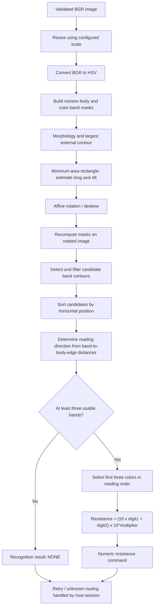
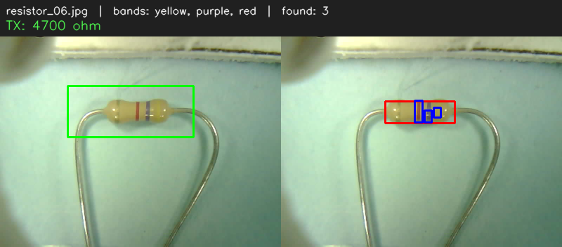
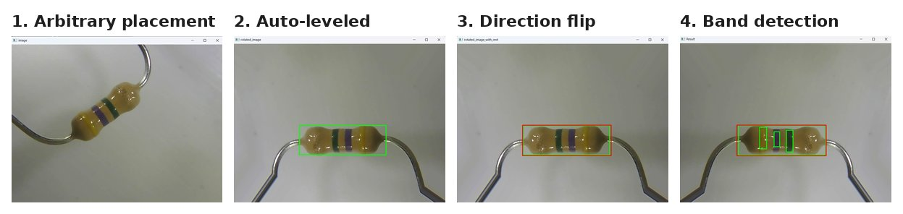

# Computer Vision and Resistor-Decoding Pipeline

## Implementation scope

The host processes images with **Python, OpenCV and NumPy**, using configurable **HSV thresholds** rather than a trained classifier. The implemented decoder extracts **three selected color bands** (two significant digits and a multiplier); it does not decode tolerance or provide general five-/six-band decoding. This chapter describes the behavior in [`detector.py`](../src/vision/detector.py), with thresholds in [`hsv_thresholds.json`](../config/hsv_thresholds.json) and adjustable processing parameters in [`settings.example.yaml`](../config/settings.example.yaml).

The ESP32-CAM takes an operator-triggered JPEG. The host validates image input separately from recognition failure: a corrupt or invalid image does not count as a failed resistor recognition and does not advance the retry state. For capture admission and image transport see [Capture delivery](capture_delivery.md) and [Protocol](protocol.md).

## Computer vision pipeline

## Stage-by-stage implementation

1. **Input validation and resizing.** `detect_file`, `detect_bytes`, and `detect` validate decoded image data and dimensions before `_detect_valid`. Invalid input is surfaced as `input_error`; it is not silently treated as an ordinary `NONE` recognition.
2. **HSV segmentation.** `cv2.cvtColor(..., cv2.COLOR_BGR2HSV)` converts the resized BGR frame. `HsvRange.mask` applies `cv2.inRange` to body and band thresholds stored in JSON. Color-mask insertion order is significant.
3. **Contour localization and orientation.** The first-pass union mask combines the resistor body and color bands; external contours are extracted, and the largest contour is passed to `cv2.minAreaRect`. The long-axis angle is normalized to avoid differences between OpenCV rectangle-angle conventions.
4. **Deskew and segmentation.** An affine rotation makes the resistor approximately horizontal. Body/band masks are recomputed and candidate band contours are filtered by the implemented area, shape, location and deduplication rules.
5. **Special-case mask handling.** Large black contours are suppressed as likely background or shadow. Purple-band erosion is skipped to avoid erasing thin, faint candidates.
6. **Direction and decoding.** Candidates are ordered spatially; distances between terminal bands and body boundaries inform which end should be read first. The first three selected colors are mapped through `COLOR_CODE`, producing two significant digits and a nonnegative multiplier.

**Example:** Yellow–violet–red produces `(10 × 4 + 7) × 10² = 4700 Ω` in the `resistor_06.jpg` sample demonstration.

*Demonstration output for `resistor_06.jpg`: detected tilted contour and deskewed candidate bands. Additional image classifications are in [media notes](images/README.md).*

### First prototype of the orientation stage

*August 2024 prototype: a resistor placed at an arbitrary angle is leveled, flipped into reading order, then segmented into bands. This logic became stages 3–6 above.*

## Recognition result versus routing decision

The detector returns a numeric resistance or `NONE`. It does **not** itself guarantee that a computed value is one of the Arduino's configured destinations. Numeric predictions outside the 26-entry routing table are transmitted and handled as unknown by the Arduino. A first valid `NONE` causes `MOTOR_ADJUST`; the operator then triggers another capture. A second valid `NONE` causes `NONE` dispatch to the unknown destination. See [Architecture](architecture.md), [Protocol](protocol.md), and [Mechatronics](mechatronics_and_control.md).

## Calibration notes

HSV thresholds depend on illumination, reflections, color similarity, and image focus. Use the interactive [HSV calibration tool](../tools/hsv_calibrator.py) to inspect masks and adjust `config/hsv_thresholds.json` (especially gray and white ranges) when lighting or camera optics change. The undergraduate team tuned per-color ranges against reference resistors under a fixed light source; see the [lighting study](images/lighting_comparison.jpg) and the [gray/white confusion examples](images/neutral_color_confusion.jpg).

For practical troubleshooting, see [Troubleshooting and calibration](troubleshooting_and_calibration.md); for parameter definitions and run modes, see [Software](software.md).
