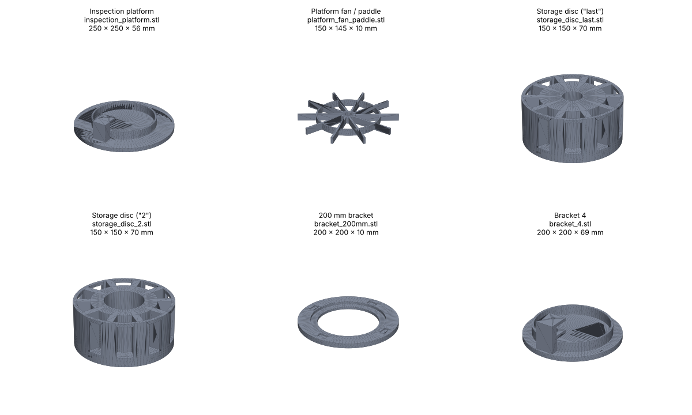

# 3D-Printable CAD Parts (STL)

These are the STL exports made for 3D printing during the undergraduate capstone. The team's CAD lead modeled them.

| File | Part | Bounding box (X × Y × Z, mm) | Triangles | Export date |
| --- | --- | --- | ---: | --- |
| [`inspection_platform.stl`](inspection_platform.stl) | Inspection platform: circular tray with camera/lens mount block | 249.9 × 250.0 × 56.0 | 1,536 | 2024-05-24 |
| [`platform_fan_paddle.stl`](platform_fan_paddle.stl) | Ten-blade fan/paddle (driven by stepper M4) that pushes the inspected resistor into the drop opening | 150.0 × 144.5 × 10.0 | 1,112 | 2024-06-26 |
| [`storage_disc_last.stl`](storage_disc_last.stl) | Rotating storage disc with 10 compartments | 150.0 × 150.0 × 70.0 | 2,116 | 2024-06-26 |
| [`storage_disc_2.stl`](storage_disc_2.stl) | Alternate storage-disc variant (same envelope, different center opening) | 150.0 × 150.0 × 70.0 | 2,100 | 2024-06-26 |
| [`bracket_200mm.stl`](bracket_200mm.stl) | 200 mm ring support plate | 200.0 × 200.0 × 10.0 | 1,244 | 2024-05-31 |
| [`bracket_4.stl`](bracket_4.stl) | 200 mm platform-base variant with camera-mount block | 200.0 × 200.0 × 69.0 | 1,532 | 2024-05-31 |

## Notes

- **Units:** millimetres.
- **Revision:** The parts were exported in May–June 2024. The final tower in [`system_overview.jpg`](../../docs/images/system_overview.jpg) adds the summer 2024 refinements described in [Design evolution](../../docs/design_evolution.md).
- **Scope:** The set covers the printed platform, paddle, storage discs and brackets. Shaft couplers, motor mounts and the lighting fixture are not included.
- **Format:** ASCII STL. The files are marked `-text` in `.gitattributes` so that Git keeps their line endings unchanged.

## Rights

**All rights reserved.** No open-source license is provided. See [Project history and sources](../../docs/provenance.md).
